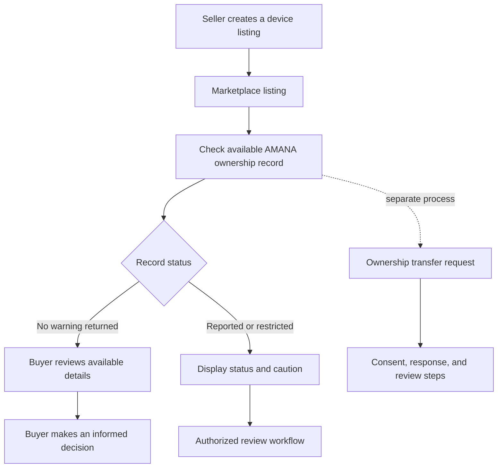

🛡️ AMANA

Secure Digital Property Ownership & Protection System

Trust the device. Verify the record.

youtube video: - https://youtu.be/fQf5Cl7lYww

🛡️ The mission
Buying a second-hand phone or laptop should not require a buyer to rely only on a listing or a seller's promise. AMANA is being developed as an electronics marketplace paired with ownership-record workflows, transfer requests, and lost-or-stolen reporting.

The idea is simple: help buyers and sellers make more informed decisions by making relevant device records and report statuses easier to check, while treating personal information and disputed claims carefully.
Important: AMANA is a project prototype. An AMANA record is not, by itself, proof of legal ownership, and a report is not proof that a device was stolen. AMANA is not an official government registry or law-enforcement system.

🎯 The problem AMANA addresses
- Uncertain ownership: a product listing alone cannot establish a seller's right to sell a device.
- Limited history: buyers may have difficulty finding out whether an AMANA record contains a warning or an unresolved dispute.
- Risky transfers: changes of ownership need clear consent, authorization, and traceable status changes.
- Sensitive information: ownership workflows must avoid exposing unnecessary personal details.
⚡ How it works

A record lookup can only report what the platform knows. No record does not mean a device is safe, and a reported status should not be treated as a final legal finding without appropriate review.
✨ Capabilities represented in the codebase
Area	What is represented	What still needs verification
🛍️ Marketplace	Product listing and browsing flows, cart and order-related entities/workflows	Test the full buyer and seller journey end to end
🗂️ Ownership records	Ownership-record entity, registration and check workflows	Validate record accuracy, access boundaries, and error handling
🔁 Ownership transfers	Initiation and response workflows	Test consent, authorization, duplicate requests, and edge cases
🚨 Lost/stolen reports	Protection-report workflow and related records	A report must remain distinguishable from a verified finding
🧾 Seller verification	Submission and staff review workflows	Do not claim external identity verification unless a real provider integration is enabled and tested
⚖️ Disputes and investigations	Dispute, investigation-case, and staff-decision workflows	Verify staff permissions and all decision paths
🧰 Support and audit	Support-ticket and audit-log entities	Validate completeness, retention, and access to audit data
💳 Payment-related code	Stripe-related integration and webhook code	Live payments are not confirmed; provider configuration and end-to-end tests are required

The table describes code and workflows present in the project; it does not claim that every feature is production-ready or fully tested.
🔐 Security by design
AMANA handles workflows where authorization and careful data handling matter. Security work should prioritize:
- Server-side authorization: enforce permissions in backend functions, not only by hiding frontend controls.
- Least privilege: limit each user and staff role to the actions and records it needs.
- IDOR/BOLA resistance: verify access to every requested record against the authenticated user's permissions.
- Data minimization: return only the fields required for an ownership check; do not expose private identity or contact information unnecessarily.
- Auditable decisions: record important state changes and review decisions where appropriate.
- Input validation: validate user-controlled values on the server and handle unexpected states safely.
- Secret hygiene: never commit API keys, access tokens, private environment files, or real customer/device records.
These are security design priorities, not a claim of an independent security audit or certification. Before production use, run authorization tests, IDOR/BOLA checks, privilege-escalation tests, input validation tests, dependency checks, and a privacy review.
🧱 Technology stack

  
  
  
  
  
  

The repository includes a React/Vite frontend, Tailwind CSS, Base44 entity definitions and backend functions, and Stripe-related integration code. Refer to [`package.json`](./package.json) for the exact dependency definitions.
🗺️ Repository map
.
├── assets/
│   └── amana-cyber-hero.gif    # Animated README hero
├── base/
│   ├── entities/               # Data entity definitions
│   ├── functions/              # Backend workflow functions
│   └── shared/                 # Shared backend helpers
├── src/
│   ├── api/                    # Base44 client/API setup
│   ├── components/             # Reusable UI components
│   └── pages/                  # Application pages
├── package.json
├── vite.config.js
└── README.md
🚀 Run locally
Prerequisites
- Node.js and npm compatible with this project's dependencies
- Access to the associated Base44 application
- Base44 CLI and Deno for the Base44 local backend workflow
Setup
1. Clone the repository and open a terminal in the project root—the directory containing package.json.
2. Install dependencies:
   npm install
   On Windows PowerShell, if the npm.ps1 script is blocked by execution policy, try npm.cmd install instead of changing system-wide policy settings.
3. Install the Base44 CLI if it is not already available:
   npm install -g base44@latest
4. Sign in and link the project to the correct Base44 application:
   base44 login
   base44 link
5. Start the app with the Base44 local workflow:
   base44 dev
6. Open the local URL printed in the terminal. Use the actual URL reported by the CLI rather than assuming a particular port.
The project may require an initial publish in Base44 before local backend development works. Be careful with remote-development modes because they may interact with remote application data.
Available npm scripts
npm run dev       # Vite frontend development server
npm run build     # Production build
npm run lint      # ESLint checks
npm run typecheck # TypeScript/JS project checks
npm run preview   # Preview a production build
These commands are defined in package.json; their success has not been verified for this submission. Run them in your environment and report the actual results. The plain Vite server may not provide all backend functionality that the Base44 workflow supplies.
🔧 Configuration and secrets
The project references these frontend environment variable names:
- VITE_BASE44_APP_BASE_URL
- VITE_BASE44_APP_ID
- VITE_BASE44_FUNCTIONS_VERSION
Use the values for your own authorized Base44 application and inspect the project configuration before running it. Never guess credentials or commit .env files. Any variable prefixed with VITE_ is exposed to the browser bundle, so never put server-side secrets in a VITE_ variable.

Before pushing to GitHub, review the repository for API keys, access tokens, private identity documents, personal data, production URLs that should remain private, and local environment files.
⚠️ Current status and limitations
- Development status: local development. A public repository, video presentation, and deployed demo have not yet been added to this README.
- Not an official registry: AMANA is not affiliated with or a replacement for government, police, courts, financial institutions, or official identity services.
- No arbitrary device tracking: the current project should not be described as able to locate any phone or laptop. A future recovery feature would require a properly enrolled device, explicit permissions, a secure integration, and lawful processing.
- Payments not confirmed live: Stripe-related code is present, but real payments require correct provider configuration, protected server-side secrets, webhook validation, and end-to-end tests.
- External identity verification not implied: do not claim Fayda or any other external verification integration unless it has been authorized, implemented, and tested.
- Not security-certified: security-related functions are not proof that the system is production-ready. Review the implementation before handling real user data.
👥 The team
#	Full name	CTC ID
1	Selam Girma	CTC-2494-26
2	Elshaday Biniyam	CTC-7610-26
3	Samuel Tefera Abate	CTC-2503-26
4	Eyuel Abdissa Debele	CTC-429-26

Team size: 4. Please verify spelling and CTC IDs against the official team records before final submission.
🎥 Submission links
- GitHub repository: Add the repository URL after creating it.
- Five-minute video presentation: Add the video URL after recording and uploading it.
- Live demo: Add only when a working deployment is available.
🧭 Next steps
- [ ] Run the app and test core user journeys with non-sensitive test data.
- [ ] Run npm run build, npm run lint, and npm run typecheck; document any failures honestly.
- [ ] Test backend authorization and record access, especially IDOR/BOLA and staff-role boundaries.
- [ ] Review privacy, data retention, report review, and dispute-handling behavior.
- [ ] Record a five-minute demo showing real, working behavior.
- [ ] Add the final repository and video URLs.
⚖️ Responsible use
Use test data for demonstrations. Treat reports as reports until appropriately reviewed; do not label a person or device as stolen based only on an unverified claim. Collect only necessary personal information, restrict access to sensitive records, and define clear consent, review, and dispute procedures before any real-world launch.

  <strong>AMANA</strong> 
  Digital trust should be useful, verifiable, and honest about its limits.

